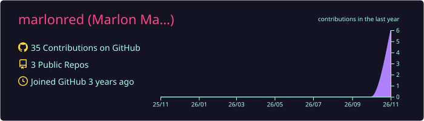
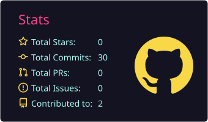
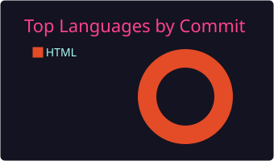

<!-- Header -->


<div align="center">

<a href="https://github.com/marlonred">
  
</a>


</div>

---

### `> whoami`

```yaml
nome:      Marlon Matheus
local:     Brasil 🇧🇷
foco:      desenvolvimento web (front-end) e automações
jogando:   Honkai: Star Rail
missão:    transformar ideias em apps que eu mesmo uso
```

### `> stack --list`

<div align="center">


</div>

### `> quests --featured`

<div align="center">

| Projeto | O que é | Stack |
| :--- | :--- | :---: |
| 🌌 **[star-rail-meta](https://github.com/marlonred/star-rail-meta)** | Tier list, builds e times do meta de Honkai: Star Rail, atualizados diariamente |  |
| ⛅ **[weatherprev](https://github.com/marlonred/weatherprev)** | Aplicação de previsão do tempo |  |
| 🪪 **[cpfgen](https://github.com/marlonred/cpfgen)** | Gerador de CPF para testes |  |

</div>

### `> stats --player marlonred`

<div align="center">







</div>

### `> connect`

<div align="center">

<a href="https://www.instagram.com/marlonred.rar/"></a>
<a href="https://www.linkedin.com/in/marlon-rodrigues-b34a77180/"></a>
<a href="mailto:marlon.matheus@gmail.com"></a>

</div>

<div align="center">

<picture>
  <source media="(prefers-color-scheme: dark)" srcset="https://raw.githubusercontent.com/marlonred/marlonred/output/snake-neon-dark.svg" />
  <source media="(prefers-color-scheme: light)" srcset="https://raw.githubusercontent.com/marlonred/marlonred/output/snake-neon-light.svg" />
  
</picture>

</div>

<!-- Footer -->

